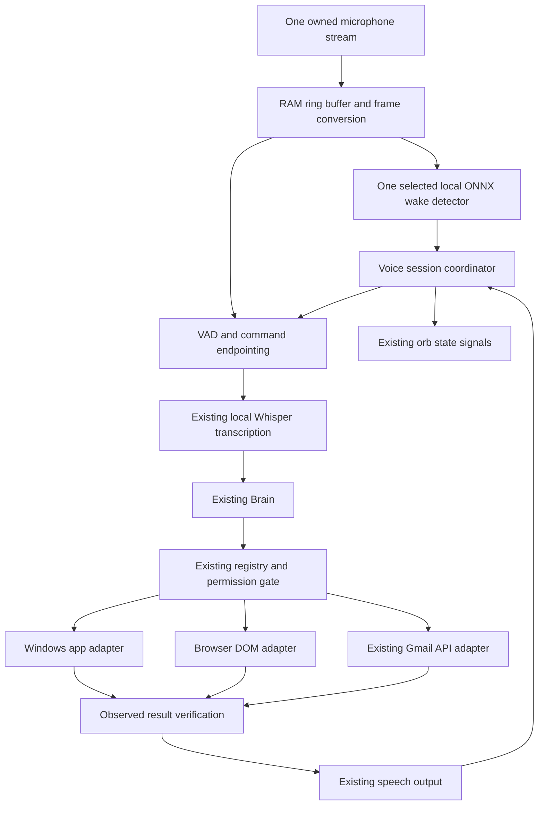

# Integration report: ambient voice and desktop control for IRIS

> Active implementation sequence: [phase.md](phase.md), roadmap R0–R13 (15 Oct 2026). The former Phase 1–7 plan is [archived](PHASES_LEGACY.md); earlier numbered phases below describe prototype history.

Reviewed 15 Oct 2026 against `IRIS_VISION.md` and the current IRIS source.

## Recommendation

Keep IRIS's orb, local Whisper transcription, speech output, shared Brain,
registry, permission gate, logs and Gmail OAuth implementation. Add the missing
capabilities as adapters rather than replacing IRIS with another application.

- **Heliox:** learn from its voice coordination, installed-app discovery,
  accessibility snapshots, window targeting and bounded task execution. Adapt
  selected ideas/components; do not fork its entire desktop product for IRIS.
- **LiveKit WakeWord:** preferred candidate to evaluate for training a custom
  IRIS ONNX classifier and running it locally. Use its inference API inside
  IRIS's own microphone owner rather than adopting its microphone listener unchanged.
- **openWakeWord:** streaming baseline and alternative runtime; useful VAD,
  thresholding, verifier and training references. Benchmark against LiveKit with
  the same audio before selecting one production runtime. Do not run both by default.
- **pywinauto:** first Windows app-control adapter candidate, using its UIA backend
  and Win32 backend where required. Evaluate `uiautomation` as an alternative if
  a needed control/pattern is easier to access there; do not add both upfront.
- **Browser adapter:** still needed separately for WhatsApp Web, mail webpages
  and feeds. These audio/UIA references do not replace browser DOM automation.

These are engineering recommendations from source/document inspection, not
completed integrations or claims of measured performance on the owner's laptop.

## What was inspected

Existing Heliox clone plus two newly requested public clones; Git was used because
`gh` is unavailable. No setup scripts, models, tests or foreign runtime code were
executed. No dependencies were installed and no microphone/accounts were accessed.

| Reference | Inspected revision | Local checkout |
|---|---|---|
| Heliox-OS | `79af30e810600a62c896487c1a8bd0787a11b6e3` | `Heliox-OS-reference/` |
| openWakeWord | `368c03716d1e92591906a84949bc477f3a834455` | `openWakeWord-reference/` |
| livekit-wakeword | `fb92cb3641fedceb0bd8442409e14d1224f7fc97` | `livekit-wakeword-reference/` |

Also checked official pywinauto, Python-UIAutomation-for-Windows and Microsoft UI
Automation documentation. A repository checkout can differ from the published
package; compatibility must be checked against the exact version ultimately pinned.

## Corrections to the proposed reference descriptions

1. **Heliox wake listening is not the same as a dedicated keyword model.** Its
   `ContinuousVoiceListener` checks recognized utterances for wake phrases. Learn
   its session, VAD and cancellation design while using a small ONNX detector for
   IRIS standby, so Whisper inference does not run continuously.
2. **One training command does not remove training work.** LiveKit provides
   `run <config>` to orchestrate generation, augmentation, training and export;
   setup, data/model downloads, compute, configuration and held-out evaluation
   still matter. Windows inference and Windows training are separate feasibility
   questions; the documented training setup primarily shows macOS/Linux tooling.
3. **False activations can be reduced, not eliminated.** Thresholds, debounce,
   representative negative audio and optional speech/verifier checks need measured
   tuning. LiveKit's upstream comparison uses a particular hey-livekit dataset;
   those results are not an accuracy estimate for IRIS or this microphone.
4. **UIA is Microsoft's platform; `uiautomation` is one Python wrapper.** We
   should not describe that specific wrapper as the implementation inside UiPath
   or Blue Prism without evidence.
5. **Property IDs do not make every editor writable.** UIA properties identify
   controls and state; supported control patterns supply operations. `ValuePattern`
   can set a supported writable value. `TextPattern` supports text inspection and
   selection but is not a general text insertion API. Word and rich editors may
   need an app-specific document API or carefully targeted input.

Sources: [Heliox voice](https://github.com/VyomKulshrestha/Heliox-OS/blob/79af30e810600a62c896487c1a8bd0787a11b6e3/daemon/pilot/system/voice.py),
[LiveKit CLI/training](https://github.com/livekit/livekit-wakeword/blob/fb92cb3641fedceb0bd8442409e14d1224f7fc97/README.md#training-a-custom-wake-word),
[Microsoft control patterns](https://learn.microsoft.com/en-us/dotnet/framework/ui-automation/ui-automation-control-patterns-overview),
[Microsoft TextPattern](https://learn.microsoft.com/en-us/dotnet/framework/ui-automation/ui-automation-textpattern-overview).

## Integration decisions by component

### Heliox: reuse the structure of reliable desktop work

The useful parts are `applications.py` (installed-app resolution), `window_mgr.py`
(targeting and text access), `accessibility.py` (snapshot refs and stale-window
checks), `browser.py` (observable browser actions), and the voice coordinator.
Its bounded autonomous loop also demonstrates stopping on no progress rather
than endlessly replaying actions.

Adapt these concepts to IRIS's existing registered tools. A snapshot should bind
an element to a window/process and generation; if the user changes apps, refresh
before acting. Bounded traversal, timeouts and worker isolation are necessary
because an inaccessible/hung application must not freeze the orb.

Do not import the whole daemon, agent mesh, permissions, Tauri/Svelte frontend,
plugin marketplace, gestures or neural research stack. Those would duplicate or
expand IRIS's scope. Heliox also explicitly rejects voice approval for pending
confirmations: it does not supply our future voice-only sending approval flow.
Its evidence document reports only 22 of 162 actions with independent
post-condition verification; general tool coverage is not universal proof.

Sources: [application discovery](https://github.com/VyomKulshrestha/Heliox-OS/blob/79af30e810600a62c896487c1a8bd0787a11b6e3/daemon/pilot/system/applications.py),
[accessibility](https://github.com/VyomKulshrestha/Heliox-OS/blob/79af30e810600a62c896487c1a8bd0787a11b6e3/daemon/pilot/system/accessibility.py),
[approval regression](https://github.com/VyomKulshrestha/Heliox-OS/blob/79af30e810600a62c896487c1a8bd0787a11b6e3/daemon/tests/test_voice_command_dispatch.py),
[evidence](https://github.com/VyomKulshrestha/Heliox-OS/blob/79af30e810600a62c896487c1a8bd0787a11b6e3/proof.md).

### openWakeWord: a streaming baseline for local wake detection

It accepts 16 kHz PCM, recommends frames in multiples of 80 ms, maintains feature
state and exposes model reset. On Windows choose ONNX explicitly rather than
assuming Linux TFLite examples apply. Optional Silero VAD and user-specific
verifiers provide useful additional rejection mechanisms. A verifier is not
secure speaker authentication or approval authority.

IRIS currently captures 16 kHz mono float32 in 100 ms chunks. Its capture frames
need buffering/reframing and appropriate int16 conversion for openWakeWord;
calling the detector on arbitrary float32 fragments is not a complete adapter.
Keep pre-roll and detector reset rules so the start of a command is not lost and
old audio does not create another activation after a turn.

Use a downloaded existing model only for a temporary pipeline test. A working
hey-jarvis model does not establish that IRIS, let's start is detected; that phrase
needs a suitable classifier. Threshold selection must use our own positive and
negative recordings rather than inheriting 0.5 as a universal optimum.

Sources: [usage/platform guidance](https://github.com/dscripka/openWakeWord/blob/368c03716d1e92591906a84949bc477f3a834455/README.md#usage),
[streaming implementation](https://github.com/dscripka/openWakeWord/blob/368c03716d1e92591906a84949bc477f3a834455/openwakeword/model.py),
[dependency declarations](https://github.com/dscripka/openWakeWord/blob/368c03716d1e92591906a84949bc477f3a834455/setup.py).

### LiveKit WakeWord: promising custom training with a small runtime

The inspected base runtime declares NumPy and ONNX Runtime; PyTorch and training
utilities are optional extras. Training can happen in a separate environment or
machine, followed by deployment of the classifier and its required frontend
artifacts. No LiveKit room/server/cloud service is required for this local Python
inference API. Classifier ONNX alone is not the complete acoustic frontend.

Its model is stateless and expects a complete window of roughly two seconds.
The provided listener keeps 25 overlapping 80 ms frames, invokes prediction after
each new frame once full, uses threshold/debounce and pauses processing after a
hit. It owns a separate PyAudio stream. For IRIS, feed the model through our
existing sounddevice-based capture owner instead: preserve one audio lifecycle,
our cancellable process ownership and Qt responsiveness.

This implementation reprocesses overlapping windows; do not assume it has lower
CPU use than openWakeWord's stateful streaming path. Measure idle CPU, memory,
battery use and latency. Pausing the supplied listener's processing is not the
same as closing its microphone; it cannot define IRIS privacy pause unchanged.

Custom training should compare a short phrase such as Hey IRIS with the requested
IRIS, let's start using natural recordings, accents, distances and speech speeds.
A longer phrase may not fit a fixed roughly two-second window when spoken slowly;
measure it before selecting the model/window policy. Keep the owner's requested
phrase as the goal, not a silently changed requirement.

Sources: [runtime dependencies](https://github.com/livekit/livekit-wakeword/blob/fb92cb3641fedceb0bd8442409e14d1224f7fc97/pyproject.toml),
[model](https://github.com/livekit/livekit-wakeword/blob/fb92cb3641fedceb0bd8442409e14d1224f7fc97/src/livekit/wakeword/inference/model.py),
[listener](https://github.com/livekit/livekit-wakeword/blob/fb92cb3641fedceb0bd8442409e14d1224f7fc97/src/livekit/wakeword/inference/listener.py),
[export constraints](https://github.com/livekit/livekit-wakeword/blob/fb92cb3641fedceb0bd8442409e14d1224f7fc97/docs/export-and-inference.md).

### pywinauto / uiautomation: add an application adapter, not arbitrary control

Start with pywinauto's `backend="uia"` for discovery, explicit selectors, waits
and supported control patterns. Its `win32` backend can cover legacy controls.
Use `uiautomation` as an alternative behind the same interface when justified by
control inspection. Both depend on what the target app exposes; neither grants
universal access, bypasses Windows elevation or guarantees background operation.

For each supported app: resolve its window, inspect control type/AutomationId/
name and supported patterns, perform one bounded operation, then read back an
independent result. Reject ambiguous targets, password controls, stale elements
and unsupported patterns. Keep content out of ordinary action logs.

For Notepad, validate modern Windows 11 tabs/editors rather than copying an old
Win32 Notepad demo. For Word, prefer a document-specific adapter if the exposed
UIA patterns cannot reliably edit/verify rich content. For WhatsApp desktop,
inspect the installed app's current accessibility tree before promising contact
selection or composer access. App-specific sends must still use our approval gate.

Sources: [pywinauto backends/selectors](https://pywinauto.readthedocs.io/en/latest/getting_started.html),
[uiautomation controls and limits](https://github.com/yinkaisheng/Python-UIAutomation-for-Windows),
[ValuePattern.SetValue](https://learn.microsoft.com/en-us/dotnet/api/system.windows.automation.valuepattern.setvalue).

## Proposed IRIS architecture

Proposed files, not created runtime modules:

| Area | Proposed home | Changes to existing source |
|---|---|---|
| Audio ownership/pre-roll | `iris/audio/capture.py` | Refactor `ears.py` so activation and command capture do not compete for the mic. |
| Swappable keyword adapter | `iris/audio/wake.py` | Load a pinned local classifier; expose detection/reset, not tool dispatch. |
| Session/interrupt state | `iris/audio/session.py` | Integrate `VoiceController`, TTS and cancellation without a second Brain. |
| App/control inspection | `iris/desktop/adapter.py` | Lazy imports and worker isolation; never manipulate Qt widgets from this worker. |
| Registered desktop tools | `iris/tools/desktop.py` | Add narrow schemas, target binding, verification and approved effects. |
| Website workflows | `iris/tools/browser.py` plus browser adapter | Evolve URL dispatch into observable navigation/element operations. |
| Settings and display | `iris/config.py`, `iris/ui/app.py`, orb | Wake/model settings, explicit microphone states and orb-only default. |

Session states should distinguish standby wake monitoring, command capture,
processing, speaking, follow-up, privacy pause and stopped. Awake commands can
use bounded wake-free follow-ups; microphone-off pause cannot hear a resume word.
Barge-in requires a separately designed listen-during-speech path, echo rejection
and stop-priority handling. The current `_reserve()` rejects listening while busy
or speaking, so adding a wake callback alone will not deliver interruption.

A wake hit grants permission to listen, not permission to send/install. Until a
trusted voice-review/approval design is implemented, keep current GUI Gmail
confirmation intact. Edits must invalidate approval; uncertain sends must never
be replayed automatically. Newly observed web/app text is untrusted information.

## What these references still do not deliver automatically

| Requested workflow | Remaining IRIS work |
|---|---|
| Write and correct Notepad text | Modern editor targeting, Unicode/multiline support, selection/replace/undo and read-back. |
| Mail by voice | Existing Gmail account acceptance plus trusted spoken review/approval. |
| WhatsApp desktop/web | App/web choice, sign-in handling, contact disambiguation, compose/correct/review/send and observed outcomes. |
| Scroll reels | Correct app/feed targeting, next/previous actions, bounded continuous scrolling if requested and reliable spoken stop. |
| Microsoft Store installs | Store identity/publisher/price review, exact-app confirmation, install progress and installed-app verification. Heliox's generic package tool is insufficient by itself. |
| All-day keyboard-free use | Startup packaging, sleep/resume, device recovery, provider errors, local command fallback and hardware acceptance. |

## Dependency, model and license considerations

| Component | Relevant finding | Integration consequence |
|---|---|---|
| Heliox code | MIT | Retain notices for substantial reused code; avoid importing its entire application. |
| openWakeWord code | Apache-2.0 | Track notices and the exact runtime/model version. |
| Included openWakeWord pretrained classifiers | README specifies CC BY-NC-SA 4.0 | Do not equate code license with unrestricted model redistribution/commercial use. |
| LiveKit code | Apache-2.0 | Review bundled frontend artifacts and the training/TTS/data licenses for the chosen model separately; repository code license alone does not prove every trained asset's terms. |
| Training environments | LiveKit extras include PyTorch/audio/export tools; openWakeWord full extras include older strict pins | Keep training separate from IRIS's `.venv`; do not install all extras into the desktop runtime. |
| Runtime versions | Existing IRIS has NumPy, faster-whisper and native Windows dependencies | Test a pinned ONNX/runtime/UIA combination on Python 3.11 target and available 3.12 environment; do not claim compatibility from version ranges alone. |

This is an artifact/dependency inventory, not a legal conclusion about a future
release. No model/data licensing audit or installation compatibility test ran.

Sources: [openWakeWord license distinction](https://github.com/dscripka/openWakeWord/blob/368c03716d1e92591906a84949bc477f3a834455/README.md#license),
[LiveKit manifest](https://github.com/livekit/livekit-wakeword/blob/fb92cb3641fedceb0bd8442409e14d1224f7fc97/pyproject.toml), [Heliox license](https://github.com/VyomKulshrestha/Heliox-OS/blob/79af30e810600a62c896487c1a8bd0787a11b6e3/LICENSE).

## Implementation sequence and evidence required

1. **Baseline and interface:** preserve existing behavior/tests; restore orb-only
   startup and define capture/wake/session/desktop adapter contracts.
2. **Audio feasibility:** train or obtain an appropriately licensed IRIS classifier
   outside the runtime environment. Compare LiveKit and openWakeWord on identical
   held-out recordings. Select one engine based on measured false wakes/hour,
   missed wakes, wake latency, CPU/RAM and battery impact.
3. **Hands-free session:** one mic owner, pre-roll, local wake inference, command
   endpointing, Whisper after activation, follow-ups, pause/resume boundaries and
   bounded interruption. Confirm that media/TTS does not execute commands.
4. **One real desktop workflow:** target Notepad from another foreground app,
   insert multiline Unicode, correct a sentence and read back the result. Test
   two windows, tab changes, stale controls, timeouts and cancellation.
5. **Expand adapters:** add browser inspection and supported WhatsApp workflows;
   preserve Gmail API integration. Implement trusted voice approval as its own
   milestone, then add Store review/install and feed controls.
6. **Release acceptance:** test noise/TV/headphones, immediate post-wake speech,
   accents, mic disconnect, sleep/resume, provider outage, stop during every stage,
   duplicate sends/install requests and full-day operation without restart.

Suggested initial wake acceptance targets (project proposals, not measured facts):
90% or better recall on a held-out set of at least 100 natural owner utterances,
no false wakes during an initial eight-hour representative negative-audio run,
and no unintended consequential action. Zero observed false wakes in a short run
does not prove a zero false-wake rate. Set latency/resource budgets after baseline
measurements rather than promising unspecified low-power performance.

**Best first integration:** the single-owner ambient audio/session foundation with
an evaluated IRIS keyword model, followed by verified Notepad control. This closes
the two largest structural gaps before attempting broad app workflows.
